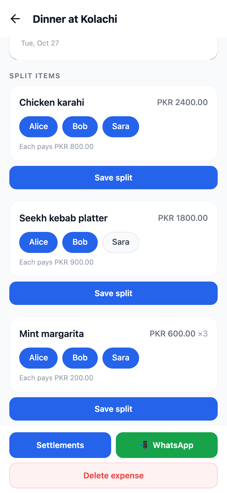
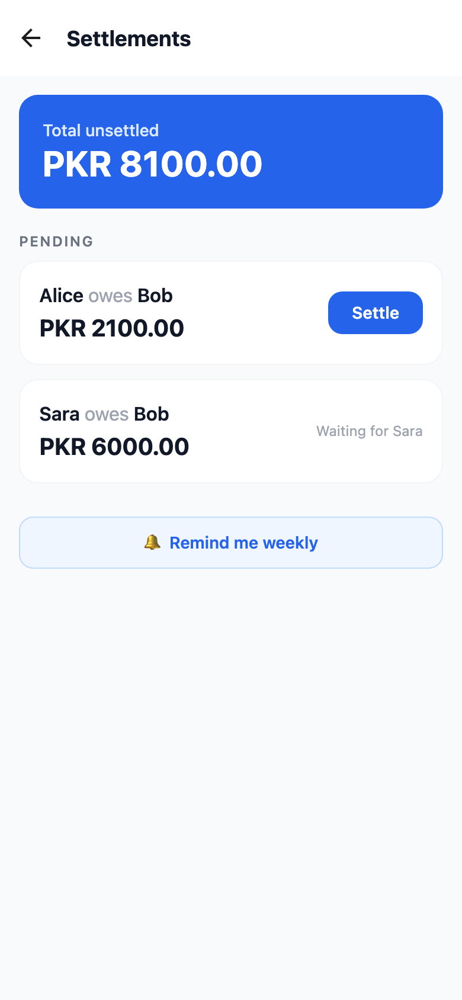
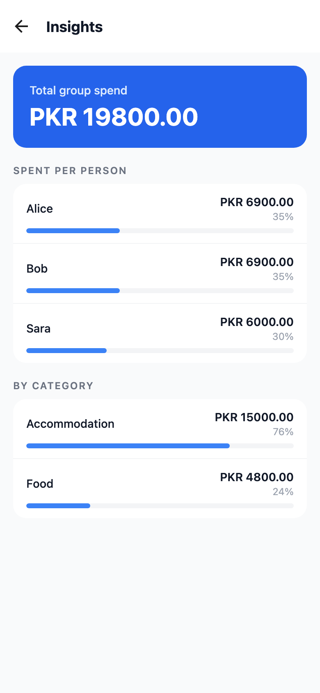
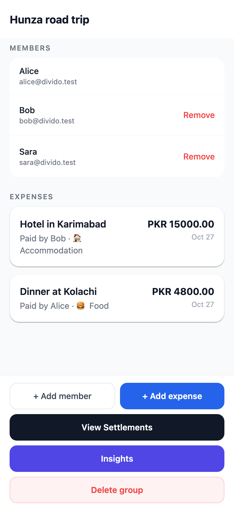
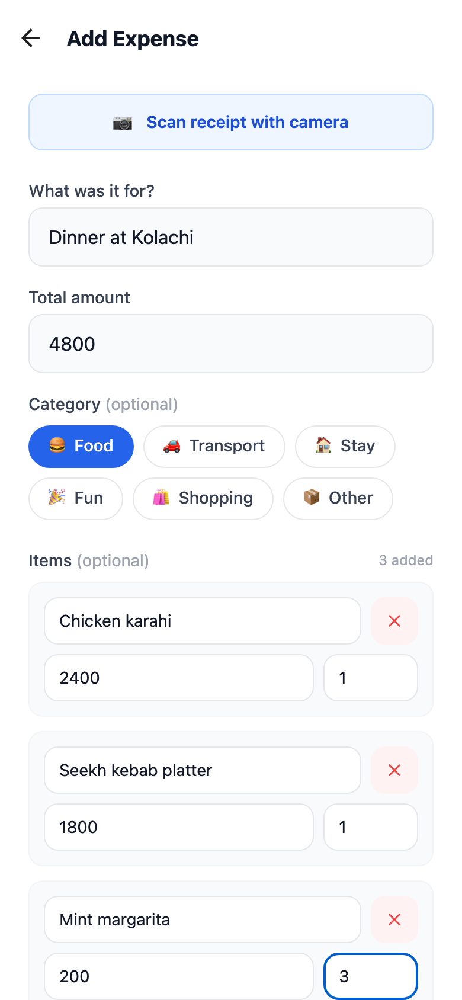
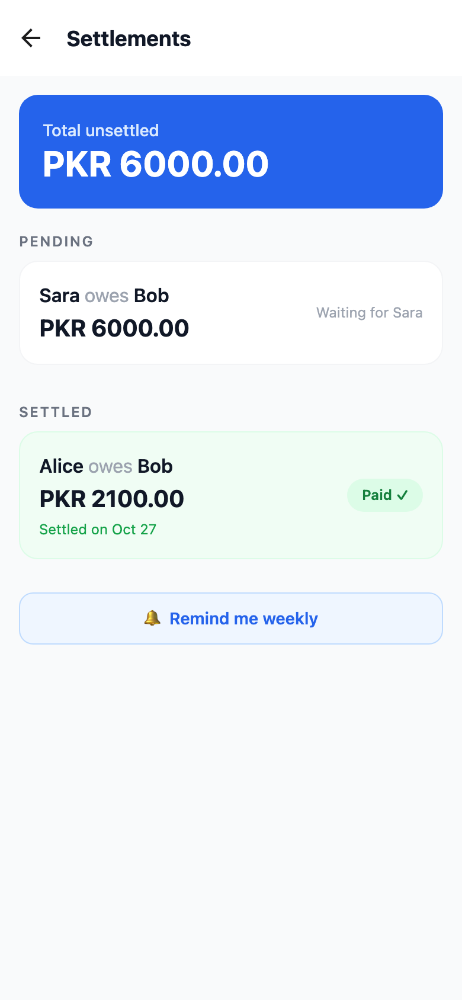
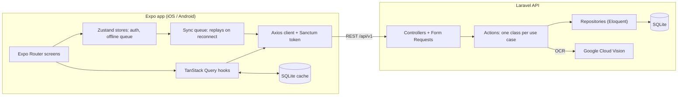

# Divido

**Split a group bill by what each person actually had, and settle it in as few payments as possible.**

Divido is a mobile app for friends who share costs on trips, dinners and flats. Instead of dividing every bill evenly, you log the line items (or scan the receipt), tap who had what, and Divido works out who owes whom across the whole group. It is an Expo (React Native) app backed by a Laravel API, in one pnpm monorepo.

<p align="center">
  
</p>

<p align="center"><a href="docs/demo/divido-demo.mp4">Watch the 30 second demo (MP4)</a></p>

## Why it exists

Even splits are unfair the moment one person skips the drinks or orders the expensive dish, and keeping a running tab across a week-long trip gets messy fast: everyone ends up owing everyone a little. Divido tracks splits at the item level and keeps one settlement plan per group, so a group of friends pays each other back with a short list of transfers instead of a web of small IOUs.

## What it does

| | |
| --- | --- |
| **Item-level splits.** Each line item on a bill is assigned to the people who had it and divided evenly between them. The app shows each person's share as you tap. |  |
| **Netted settlements.** Every split change rebuilds the group's plan. Balances are netted across all expenses and a greedy match pairs debtors with creditors, so four pairwise debts become two payments. Only the person who owes can mark a payment as paid. |  |
| **Spending insights.** What each member's share of the group's spending came to, and the split by category. |  |

Also in the app:

- **Receipt scanning.** Take a photo, send it to the API's OCR endpoint (a Google Cloud Vision proxy), and a parser turns the text into editable line items you review before saving.
- **"Usually split with" suggestions** based on who shared items with the same name before.
- **Offline support.** Groups and expenses are cached in SQLite. New expenses, split changes and settlements made offline are queued and replayed when the connection returns.
- **WhatsApp sharing** of an expense summary (native share sheet as a fallback) and **weekly settle-up reminders** through local notifications.

## A typical flow

1. Alice creates "Hunza road trip" and adds Bob and Sara by email.
2. She logs "Dinner at Kolachi" with three items and taps who had each one.
3. Bob adds the hotel from his own account; the plan updates for everyone.
4. The settlements screen shows the two payments that clear every debt. Alice pays Bob and marks hers as paid; it moves to the settled list and stays netted out of future plans.

| Group | New expense | After settling |
| --- | --- | --- |
|  |  |  |

All screenshots and the demo come from the real app running locally on react-native-web against the Laravel API, with the seeded demo accounts. There is no hosted version.

## How it works



**Mobile.** Routes live in `app/` (Expo Router) and stay thin. Everything else is organised by domain under `src/features/<domain>/`, each with `services/` (HTTP calls), `hooks/` (React Query) and `components/`. Server state is owned by React Query; Zustand only holds the auth session and the offline write queue, both persisted. The auth token goes to the Keychain/Keystore through `expo-secure-store`.

**API.** Controllers do no business logic. A Form Request validates and authorises the call, a DTO carries the typed input, an Action runs the use case (`CreateExpenseAction`, `UpdateItemSplitsAction`, `RegenerateGroupSettlementsAction`, ...), and Repositories hold the Eloquent queries. API Resources shape every response into a `{ data, message }` envelope. Authentication is Laravel Sanctum bearer tokens.

### Decisions worth calling out

- **Settlements are derived, never edited.** Pending settlements are deleted and rebuilt from splits whenever splits change or an expense is deleted, inside the same database transaction as the change. Payments already marked as settled are subtracted from balances first, so editing an old bill never asks someone to pay twice.
- **Authorisation follows the data, not just the URL.** Updating splits checks that the item belongs to the expense in the URL and that every person in the split is a member of that group, so a member of one group cannot touch another group's items.
- **The server wins offline conflicts.** When a queued write comes back with a 4xx (the expense was deleted, the debt was already settled), the app drops it and refetches. A 5xx or network error keeps it queued for the next reconnect, and replay stops at the first failure to preserve order.
- **OCR goes through the backend.** The Vision API key never ships in the app. Calls are bounded by a 15 second timeout, the key is sent as a header rather than a query parameter so it stays out of logs, and failures map to a clear 502 so the app can fall back to manual entry.

## Data model

| Table | Purpose |
| --- | --- |
| `users` | Accounts (email and password) |
| `groups`, `group_user` | Groups and their members; the creator can delete the group or remove members |
| `expenses` | A bill in a group: title, total, optional category, who paid |
| `expense_items` | Line items: name, price, quantity |
| `item_splits` | Who shares an item and their amount |
| `settlements` | Derived "A pays B" rows, `pending` or `settled` |

All endpoints are under `/api/v1` and documented in [`docs/API_CONTRACTS.md`](docs/API_CONTRACTS.md). With the API running, Swagger UI is served at `/api/documentation`.

## Tech stack

| Area | Used |
| --- | --- |
| Mobile | Expo SDK 55, React Native 0.83, Expo Router, TypeScript (strict), TanStack Query, Zustand with immer, NativeWind, expo-sqlite, expo-camera, expo-notifications |
| API | Laravel 13 on PHP 8.4, Sanctum, L5-Swagger (OpenAPI 3), Google Cloud Vision |
| Data | SQLite (development and tests). Other Laravel database drivers should work but have not been tried |
| Testing | Jest with jest-expo, React Native Testing Library, MSW 2; Pest 4 |
| Tooling | pnpm workspaces, ESLint 9, Prettier, Laravel Pint, GitHub Actions |

## Getting started

Requirements: Node 22 (`.nvmrc`), pnpm 10 (`corepack enable` picks up the pinned version), PHP 8.4 with `pdo_sqlite`, Composer, and Xcode or Android Studio for native builds.

```bash
pnpm install

# API
cd apps/api
composer install
cp .env.example .env
php artisan key:generate
touch database/database.sqlite
php artisan migrate
php artisan db:seed            # demo users alice, bob and sara @divido.test, password "password"
php artisan serve --port=6501  # http://localhost:6501

# Mobile (new terminal)
cd apps/mobile
cp .env.example .env           # points the app at http://localhost:6501/api/v1
pnpm ios                       # or: pnpm android
```

The app uses native modules (camera, SQLite, notifications), so it needs a development build (`expo run:ios` / `expo run:android`) rather than Expo Go. On a physical device, set `EXPO_PUBLIC_API_URL` to your machine's LAN IP.

**Trying it in a browser.** `pnpm --filter mobile web --port 6503` runs the same app on react-native-web against the local API. Groups, expenses, splits, settlements and insights all work there. Receipt scanning, notifications and WhatsApp sharing need a device; the web build keeps the auth token in localStorage instead of the Keychain; and native confirmation dialogs do nothing on web, so deleting an expense can only be tried on a device.

### Environment variables

| App | Variable | Purpose |
| --- | --- | --- |
| mobile | `EXPO_PUBLIC_API_URL` | API base URL including `/api/v1`, e.g. `http://localhost:6501/api/v1` |
| api | `APP_KEY`, `APP_URL`, `DB_*` | Standard Laravel settings; SQLite works out of the box |
| api | `GOOGLE_VISION_API_KEY` | Google Cloud Vision key, only needed for receipt OCR |

`.env` files are gitignored; only the `.env.example` templates are committed.

## Project structure

```
apps/
  mobile/
    app/                 Expo Router routes: (auth) and (app) stacks
    src/features/        auth, groups, expenses, settlements, ocr, suggestions,
                         insights, notifications, sync
    src/services/        shared Axios client with auth and error interceptors
  api/
    app/Http/            controllers, Form Requests, API Resources
    app/Actions/         one class per use case
    app/DTOs/            typed input from requests to actions
    app/Repositories/    Eloquent queries
    tests/Feature/       Pest tests per endpoint
docs/
  API_CONTRACTS.md       request and response shapes for every endpoint
  PROGRESS.md            feature checklist by phase
  screenshots/, demo/    README media
```

## Testing and quality

| Command (repo root) | What it runs |
| --- | --- |
| `pnpm lint` | ESLint and Prettier (mobile), Pint (API) |
| `pnpm typecheck` | `tsc --noEmit` for the mobile app |
| `pnpm test` | Jest (mobile), then Pest (API) |
| `pnpm build` | `expo export` bundles for iOS and Android |

- **Mobile:** 91 Jest tests across 23 suites: API services against MSW handlers, React Query hooks, Zustand stores, the offline sync queue, the receipt parser, the OCR fallback, components and screens.
- **API:** 102 Pest feature tests covering every endpoint, including authorisation (non-members, cross-group item IDs), validation, settlement regeneration after payments and deletes, and the OCR proxy with `Http::fake`.

All of the above, plus the `expo export` build, pass locally on Node 22 and PHP 8.4. CI (`.github/workflows/ci.yml`) runs the same steps on pushes to `main` and on pull requests. The main flows were also exercised by hand in a browser (see the demo). The native-only features have unit tests but have not been run on a physical device.

## Status and limitations

- **Not deployed.** Divido runs locally; there is no hosted API or store build.
- **On-device OCR is a stub.** The app was designed to try Apple Vision on the device first and fall back to the Google Vision proxy below 0.75 confidence. The on-device step always reports low confidence today, so every scan uses the proxy, and camera capture has not been tested end to end on a phone.
- **One currency.** Amounts are shown in PKR and stored as 2-decimal values compared with a 0.01 tolerance.
- **Offline is partial.** Reading groups and expenses works offline, and creating expenses, editing splits and settling are queued. Other writes need a connection.
- **Accounts are basic.** No password reset, email verification or invitations; members are added by the email of an existing account.

## Next steps

- Implement the on-device OCR step, so most receipts never leave the phone (the fallback path already exists).
- Test camera capture, notifications and offline replay on physical iOS and Android devices.

## License

No license has been chosen yet, so the code is not open source. Please get in touch before reusing it.
